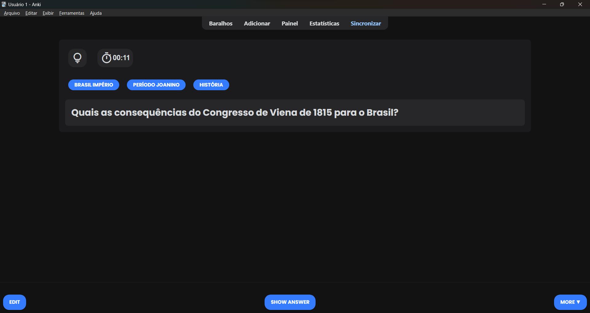
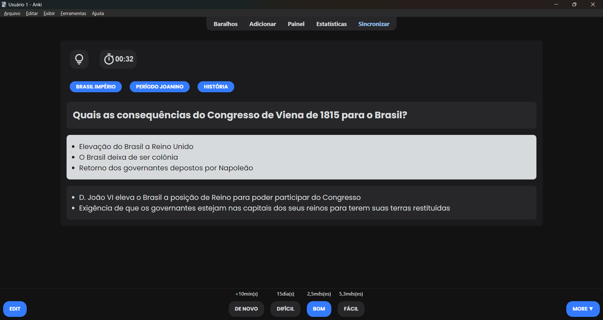

# Anki-Card-Templates 📚
I originally posted this template on Reddit using Pastebin, but I decided to delete it there and move it here to help people find it more easily.

### Note about bottom bar and top bar buttons - on Desktop App 💻
This template won't change the appearence of said buttons on Desktop App, only on mobile browser and desktop browser.
In order to change them in the Desktop App, I used Beautify add-on.

### Note about mobile 📱
 It seems to be working on the ios app.
 If someone tests it on android, please let me know if works.
 
### Note about timer ⏱️
The timer button is not synchronized with Anki's timer, so pausing it will not pause Anki's timer.

# Fields ✍️
There are six fields: front, back, extra, tip, and source.
Empty fields won't be displayed, so there is no need to fill them all.

In the upper left corner, the first button is for tips, and it is used to show or hide the tip field. Next to the tip button, there is a timer that indicates the time elapsed since the card was opened, you can pause it by clicking on it.

Below these two icons, there is a tag field that shows the card's tags as follows:
- Only the name after the last "::" is shown.
- Underscores ( _ ) are treated as spaces.

The tag "ENEM/UECE::Humanas::História::Brasil::Brasil_império," for example, will be displayed as "Brasil Império".

Just below, there are the following self-explanatory fields: Front, Back, Extra, and Tip.

# Original version - front and back - on Desktop app 💻

# Blue version - front and back - on Desktop app 💻

# Yellow version - front and back - on Desktop app 💻

# Purple version - front and back - on Desktop app 💻

# Green version - front and back - on Desktop app 💻

# Original version - front and back - on mobile browser 📱

 

# Blue version - front and back - on mobile browser 📱

 

# Yellow version - front and back - on mobile browser 📱

 

# Purple version - front and back - on mobile browser 📱

 

# Green version - front and back - on mobile browser 📱

 

# Importing 📁
You can do it by creating a note type on Anki and pasting the code from the HTML and CSS folders.

### Create note type ➕
1. Open Anki
2. Click on "Add"
3. Select Note Type
4. Click on "Manage"
5. Click on "Add"
6. Click on "Add:Basic"
7. Name the note type

### Edit the note type ✍️
1. Select the note type you created
2. Click on "Cards..."
3. Paste the code from front.html in "Front Template"
4. Paste the code from back.html in "Back Template"
5. Paste the code from one of the styles in the CSS folder in "Styling"
6. Click on "Save"

# Credits 
This template uses Material Design icons by Google and Poppins font by Indian Type Foundry and Jonny Pinhorn

- Link to Google Icons:
https://fonts.google.com/icons
- Link to Poppins font on Google Fonts:
https://fonts.google.com/specimen/Poppins?query=poppins
